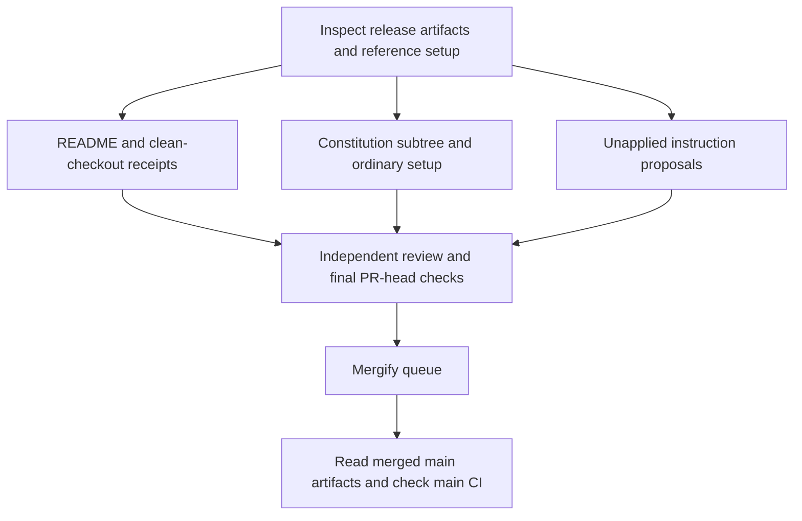

# MicroVM README and Repository Setup - Plan

## Goal Capsule

- **Objective:** Readers can accurately evaluate and use effect-microvm from its default branch and reproduce the documented paths.
- **Means:** Apply the README skill, install the upstream constitution as a tracked subtree, and adapt the reference repository's ordinary setup (KTD1–KTD4).
- **Authority:** SYS-1167 and current operator instructions govern scope; existing repository gates and package metadata govern implementation.
- **Stop conditions:** Do not invent execution evidence, change locked instruction files, bypass gates, publish packages, or mark the issue complete without verified merged-main evidence.
- **Execution:** One independent branch and PR based on main; maker implements, independent reviewers review, Mergify delivers. The outer source author alone decides and applies the reserved instruction proposals.

---

## Product Contract

### Summary

Create a repository-specific root README and ordinary repository setup, backed by clean-checkout receipts, and verify the resulting default-main artifacts. Supply complete instruction-file proposals separately without applying them.

### Problem Frame

The repository lacks a root README and common extracted-repository setup. Package documentation and main differ from published artifacts, so an otherwise plausible quick start can describe the wrong API or claim a microVM ran when virtualization was unavailable.

### Requirements

**Reader and release accuracy**

- R1. Produce the root README through the actual `write-readme-md` workflow and report the steps and numeric score in the PR.
- R2. Distinguish the published packages and their usable APIs from unreleased main, using verified artifact evidence.
- R3. Capture a clean-checkout execution receipt for every install/use claim, including prerequisites, versions, command, output, exit status, and environment; remove or explicitly qualify any claim that cannot be proven.
- R4. Demonstrate a real microVM run on a KVM-capable host and never report skipped, unsupported, or unexecuted smoke as passing.

**Repository setup**

- R5. Add the upstream constitution as a real, auditable subtree declared in `subtrees.toml`.
- R6. Adapt ordinary setup and the reference license without importing starter product content, new checks, or altered protections.
- R7. Supply complete, exact, unapplied `AGENTS.md` and `CLAUDE.md` proposals to the authorized outer source author; do not block the other work on their application.

**Delivery**

- R8. Preserve existing owners and branches, publish one independent PR to main, obtain independent review, and deliver through Mergify without approving or merging it personally.
- R9. Verify checks against the exact final PR head and verify post-merge main checks and actual merged artifacts before declaring the issue done.
- R10. Use only the existing approved Gemini browser copy route if copy rewriting is needed; no new API, spend, release, visibility change, test, check, or gate.

### Scope Boundaries

No package publish, production release, new test or CI gate, weakening of existing gates, starter-specific agent instructions, or dependency on the SYS-1135 pilot merge. Preserve historical copyright notices in copied license text. The locked root instruction files are outside the maker's write authority, even if absent in this checkout.

---

## Planning Contract

### Key Technical Decisions

- KTD1. **Separate registry and main evidence.** At the inspected head, npm latest is microsandbox `5.0.0` and daemon `1.0.0`, while main manifests name `5.1.2` and `1.0.3`. The published microsandbox README uses `vm.exec`; current main smoke uses `MicroVM.exec`. Recheck registry and inspect published tarball exports when executing, then label any main-only example as source-only and do not imply it is in a released version. The current leaf README is not authoritative for main: it still describes `vm.exec` and `mappedPorts` while the current handle exposes pipeable operations.
- KTD2. **A root map, not starter content.** Follow `write-readme-md` monorepo and library references: identify the two public packages and the private test-image package, link to useful repository-specific material, route contributor setup to `CONTRIBUTING.md`, and avoid copying starter branding or unsupported assertions. A leaf README change affects packed output, so apply the repository's patch-version rule if one is actually changed.
- KTD3. **Import the upstream tree, not a copy.** The reference `subtrees.toml` tracks `https://github.com/systemfsoftware/constitution`, name `constitution`, branch `main`, at `repos/constitution`. Follow `git-subtree-vendor`'s current scripted named-ref, signed squash-shaped import and tree audit; preserve the vendor ref. The apparent manual `git subtree` alternative risks the documented `FETCH_HEAD` mismatch (G28), so it is not the chosen path. Record the resolved upstream commit and compare the actual imported tree against it.
- KTD4. **Adapt setup instead of copying its machinery.** The reference uses `nix develop`, `.envrc`, `.gitattributes`, `CONTRIBUTING.md`, and a sandboxed `pnpm bootstrap`; this repo instead provides a Nix dev shell, the `sfs-deps` flake output, and `pnpm install`. Retain working local commands rather than claim the starter's nonexistent bootstrap or introduce its sandbox/gates. The reference root Apache-2.0 license is byte-identical to the existing daemon package license at the inspected head, and package manifests already declare Apache-2.0; use that reference license, retaining its notices.
- KTD5. **Use actual KVM evidence.** `.github/workflows/ci.yml` runs `pnpm --filter @systemfsoftware/effect-microsandbox smoke` on main or workflow dispatch, grants KVM, and requires `all journeys green`. `packages/effect-microsandbox/examples/boot-alpine.ts` checks guest execution, mapping, and cleanup. Main also runs daemon integration separately. PR affected tests are not evidence that either full main run occurred.
- KTD6. **Proposals remain outside the checkout.** Create complete proposed text and a precise diff against the actual root files or their absence for the outer source author; include project-specific facts and existing gates only, with `agent-docs` review. Deliver the proposals as a review artifact, not an applied file or copied starter instructions.

### Assumptions

- The reference's `.envrc` and `.gitattributes` are suitable ordinary setup candidates after checking their effects against this repository; omit or adapt any starter-specific machinery that would create a new gate or change existing behavior.
- A KVM-enabled CI workflow dispatch at the PR head or an approved equivalent off-host clean checkout can provide pre-merge receipts. If neither exists, keep the affected claims and issue completion blocked rather than fabricate evidence.

### Evidence and Dependencies

- Baseline: `4e34cb5ed71f04889c6ab97c0a5c56c96f4955b1`, branch `sys-1167-readme-setup`; issue [SYS-1167](https://linear.app/systemfsoftware/issue/SYS-1167/effect-microvm-deliver-repo-specific-readme-and-extracted-repo-setup).
- Package metadata: `packages/effect-microsandbox/package.json`, `packages/effect-daemon-microvm/package.json`, `packages/microvm-test-images/package.json`, `pnpm-workspace.yaml`; npm registry metadata for `5.0.0` and `1.0.0` observed during planning.
- Current main behavior: `packages/effect-microsandbox/src/running-vm.handle.ts`, `packages/effect-microsandbox/examples/boot-alpine.ts`, `packages/microvm-test-images/lib/images.json`.
- Reference: `systemfsoftware/effect-endgame-starter-kit` commit `80f85e8f3caab86ee2cf8159592da401cba7b28f`, especially `subtrees.toml`, `LICENSE`, `.envrc`, `.gitattributes`, and `CONTRIBUTING.md`.
- CI and delivery: `.github/workflows/ci.yml`, `.github/ci/pr-tests.mjs`, `.mergify.yml`, `package.json`. The repository's `pnpm check:local` is a full gate; OP28 prohibits it locally on this host. `pnpm check:ci` is likewise pending off-host evidence, not a claim about what affected-only CI ran.

### Delivery Flow

---

## Implementation Units

### U1. Establish artifact-specific README evidence

**Goal:** Make each reader-facing claim traceable to the installed artifact or source checkout.

**Requirements:** R2, R3, R4. **Dependencies:** None.

**Files:** `packages/effect-microsandbox/package.json`, `packages/effect-daemon-microvm/package.json`, `packages/effect-microsandbox/examples/boot-alpine.ts`, `packages/microvm-test-images/lib/images.json` (evidence, not necessarily edits).

**Approach:** Recheck both npm versions, tarballs, dependencies, peer requirements, and actual exports. Build a claim-to-receipt matrix for each proposed install and usage path, with separate released and main rows. Execute the exact snippets in independent clean environments, including all dependencies and image prerequisites. For main-only functionality use a fresh checkout of the exact candidate commit and the repository's Nix tarball setup. For released functionality install the actual registry artifact independently of workspace overrides. Capture nonzero exits and skips as such. Resolve inconsistencies before authoring rather than assuming current leaf README examples work.

**Execution note:** Prefer clean-install and real-runtime smoke evidence to new tests; user explicitly forbids adding tests or gates.

**Test expectation:** None added; the deliverable is documentation and setup, not new runtime behavior.

**Verification:** Receipts identify artifact digest/version, clean checkout or consumer environment, OS and virtualization, command, raw output and exit, and correspond one-to-one with all final install/use claims. Actual guest execution and cleanup need KVM, not a successful import alone.

### U2. Author repository-specific README

**Goal:** Give readers a trustworthy package map and supported first-use path.

**Requirements:** R1–R4, R10. **Dependencies:** U1.

**Files:** `README.md`; `CONTRIBUTING.md` for developer setup; existing package READMEs only if correction is needed and packed-output version policy is followed.

**Approach:** Invoke `write-readme-md`; read its monorepo, library, structure and root-design references. Apply its routing, link, humanization and visual checks to this repository. Anchor the published quick start to the verified released API and explicitly separate any verified main-only path. For each remaining snippet rerun the final literal text in a clean environment. Use only the approved Gemini browser route if copy rewriting is needed; record that route or state truthfully that rewriting was unnecessary. Run the skill's `scripts/score_readme.ts` against the final root README and record the actual numeric score and criteria output, shape classification, references, manual checks, and receipt links in the PR. Do not fabricate a target score or claim the scorer proves correctness.

**Test expectation:** None added; verify commands and links directly.

**Verification:** README has repository-specific identity and package map, no link to agent instructions, no copied starter content, no unverified command, and a reported actual score. Root development setup belongs in `CONTRIBUTING.md`.

### U3. Install the constitution and ordinary setup

**Goal:** Provide reference-aligned, reproducible repository setup without changing the product or protections.

**Requirements:** R5, R6, R10. **Dependencies:** None; coordinate final receipts with U1.

**Files:** `subtrees.toml`, `repos/constitution/`, `LICENSE`, `CONTRIBUTING.md`, and suitable `.envrc` / `.gitattributes` adaptations.

**Approach:** Follow KTD3 and the current `git-subtree-vendor` initial-setup and add workflow, including a fully populated TOML entry, config validation, no-tag fetch, signed import, and tree comparison. Follow KTD4 for setup and license. Document this repository's Nix flake and `.sfs-deps` installation path, not the starter's bootstrap. Preserve all existing license notices and report history evidence. Do not introduce reference hooks, checks, sandbox scripts, dependencies, or app content merely for visual conformity.

**Test expectation:** None added; subtree tree identity and setup commands are verified directly.

**Verification:** Configuration validates, the imported tree equals the recorded upstream tree, a clean checkout can follow contributor setup, and the root license matches the reference license while preserving existing package licenses.

### U4. Prepare reserved instruction proposals

**Goal:** Give the authorized source author complete proposals without changing locked files.

**Requirements:** R7, R10. **Dependencies:** U1 and U3 supply verified facts; drafting can proceed independently of landing.

**Files:** `AGENTS.md`, `CLAUDE.md` (read-only target surfaces); proposals delivered outside the repository diff.

**Approach:** Apply `agent-docs` rules ADOC-A1–A4 and ADOC-A14. Provide the complete exact proposed bytes for both files and a diff showing additions, changes, or absent-file creation; identify baseline commit and verification for each factual instruction. Preserve project purpose and existing owners; do not copy starter instructions or add a new gate. Explicitly label the proposal unapplied and identify the outer author as the only person authorized to apply it.

**Test expectation:** None added; independent review checks proposed text and source facts.

**Verification:** The PR diff contains no edits to the locked files, and the complete proposals are available to the outer author without blocking U2 or U3.

### U5. Review, deliver, and verify default main

**Goal:** Complete the independent slice only after the actual merged artifacts and required checks are observed.

**Requirements:** R8–R10. **Dependencies:** U1–U4.

**Files:** `.github/workflows/ci.yml`, `.mergify.yml` (read-only evidence); PR description and external receipts.

**Approach:** Run permitted scoped local checks, obtain fresh independent review, resolve all P0/P1 findings, and report P2/P3 per repository policy. Open the independent PR against main without altering existing owners or branches. Report skill process, numeric score, receipt matrix, license provenance, subtree tree comparison, and unapplied proposals. Observe required checks for the exact final PR head via REST and allow Mergify to deliver under existing policy. After merge, fetch the resulting main SHA, read the actual root README, license, subtree registry and subtree contents from that SHA, and correlate main CI, real microVM smoke, and daemon integration to it. If main has advanced, tie each verdict to the merge commit or a descendant that demonstrably contains it; do not substitute PR checks for main evidence. A maker never approves or merges the PR.

**Test expectation:** None added; existing checks and runtime receipts establish the requested behavior.

**Verification:** PR and main evidence include exact SHA, workflow/job URL, actual command, conclusion and logs, with skips distinguished from passes. Readback proves the merged bytes, not merely the PR preview.

---

## Verification Contract

| Evidence | Required result |
|---|---|
| Clean registry consumer | Each final published install/use command succeeds against the named released artifact, with captured output and exit. |
| Clean source checkout | Every documented source/setup command succeeds at the candidate SHA, with Nix-built core tarballs and matching prerequisites recorded. |
| README skill | Actual process, manual review, numeric score and scorer output are reported on the PR. |
| Subtree | `subtrees.toml` validates and imported tree matches the resolved upstream vendor tree; retain commit and tree IDs. |
| Scoped local checks | Run applicable dprint and touched-package lint, typecheck, and unit/property checks only; report exact commands and exits. Do not run local e2e, journey, integration/full gates, or mutation. |
| Off-host full gate | Repository instructions name `pnpm check:local`; `package.json` defines `pnpm check:ci`. Keep the exact required full command pending off-host and report its actual execution and result; do not describe affected-only CI as that full command. |
| Real VM | On a KVM-capable off-host runner, execute the applicable microsandbox smoke at the relevant SHA and capture `[smoke] all journeys green`, actual exit and job log. Verify daemon integration separately when claiming it. |
| PR and main | Verify exact final PR head checks, then main's required CI jobs and smoke for the merge SHA; read merged artifacts at that SHA. |

---

## Definition of Done

- R1–R10 have evidence, with no unverified release or usage claim and no skipped smoke represented as success.
- README, setup, license, and subtree exist on default main and are read back from the merged commit; actual main checks are green.
- Independent review has no unresolved P0/P1; Mergify, not the maker, delivers the PR.
- Exact locked-file proposals are handed to the authorized outer author unapplied; their independent application is not a prerequisite for the README/setup PR.
- No temporary consumer projects, receipt scaffolds, abandoned experiments, new gates, or unintended product changes remain in the repository diff.
