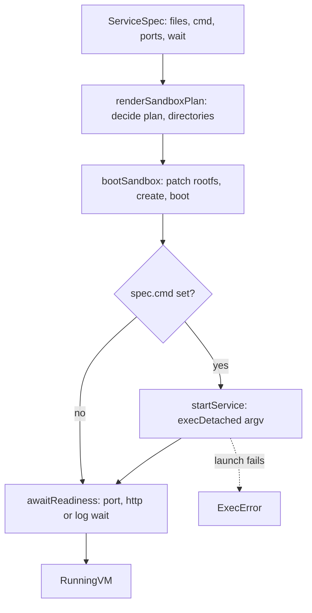

# Service command and guest files - Plan

## Goal Capsule

- **Objective:** A consumer can boot an image that needs a script the image does not contain, have that script running inside the guest, and get back a `RunningVM` only once the service is actually ready. No host-path mount is involved.
- **Means:** guest files rendered as pre-boot rootfs patches, and a service command started after boot but before the readiness wait (KTD1, KTD2).
- **Authority:** the requirements below, then the repository's `AGENTS.md` and the package's lint, API-report and test gates. Nothing that grades the work (CI workflows, lint rules, thresholds) changes in this PR.
- **Execution profile:** one pull request in this repository, `Closes #11`. The other repositories in the backlog are separate pull requests and are not planned here (see Scope Boundaries).
- **Stop conditions:** `pnpm check:local` exits 0, and the new smoke journey either passes against a real microVM on this host or is reported as unrun with the reason, leaving CI on `main` as the proof.

## Product Contract

### Summary

`ServiceSpec` gains an optional `cmd`. A new blueprint operation, `MicroVM.withCommand`, sets it, and `MicroVM.withFile` places a file in the guest from a string or bytes. Both render into the sandbox plan, and the boot sequence writes the files before the VM starts and launches the command before it waits for readiness.

### Problem Frame

`ServiceSpec` can set an image, environment, ports, mounts, limits and a wait strategy, but nothing the guest runs. `render-sandbox-plan.workflow.ts` renders every service with `cmd: undefined`, and no step puts content into the guest. A service whose image lacks the program the consumer wants to run (the common case for a stock runtime image such as `oven/bun`) can only be booted through a host-path mount, which couples the test to the host filesystem layout, or not at all. Jobs already have `cmd` and `workdir`; services have neither.

### Requirements

**Spec and operations**

- R1. `ServiceSpec` takes an optional `cmd` with the same shape as `JobSpec.cmd`.
- R2. `MicroVM.withCommand(cmd)` sets it, exported beside `withEnv` and `withMount`, and usable as a chained method on the blueprint.
- R3. A spec can carry guest files, each an absolute guest path plus content given as a string or as bytes. `MicroVM.withFile(path, content)` appends one.
- R4. Every existing `with*` operation preserves `cmd` and `files`.

**Rendering and boot**

- R5. `render-sandbox-plan.workflow.ts` renders a service's `cmd` and files into the plan instead of `cmd: undefined`, and decides the guest directories the files need.
- R6. The guest files exist before the VM's first process starts.
- R7. A service's `cmd` is started in the guest after boot and before the readiness wait, so a port, HTTP or log wait observes the started process.
- R8. A `cmd` that cannot be launched fails the boot with `ExecError` naming the argv.

**Proof and delivery**

- R9. A smoke journey boots `oven/bun` (pinned by digest) with a script placed through `withFile`, started through `withCommand`, listening on 7000, and reaches readiness through a port wait.
- R10. Unit and property tests cover the new spec fields, the operations and plan rendering.
- R11. A minor changeset for `@systemfsoftware/effect-microsandbox` states the consumer-visible change.
- R12. `pnpm check:local` exits 0.

### Scope Boundaries

Considered and not built:

- **Service `workdir`.** The brief allows it "if needed". Nothing here needs it: the journey uses absolute paths, and a consumer who wants a working directory can use `sh -c 'cd … && …'`. Evidence that would change the call: a consumer that cannot express its command without a cwd.
- **File `mode`.** `PatchBuilder` accepts a mode, but running a script through its interpreter needs no executable bit, and adding an optional field later is additive. Evidence that would change the call: a consumer that must exec a script directly.
- **An exec hook between boot and `awaitReadiness`.** It widens the public surface to arbitrary effects on the VM. Evidence that would change the call: a consumer that needs guest state a file and a command cannot produce.
- **Reporting that the command exited early.** A command that dies makes the readiness wait time out after 30 seconds with `WaitTimeoutError`, which names the wait. That surfaces the failure to the person who can fix it.
- **Stopping the command on scope close.** `release` already stops and destroys the sandbox, which takes the process with it.

Deferred to follow-up work: none.

## Planning Contract

### Key Technical Decisions

- KTD1. **Guest files are rootfs patches, not an exec hook.** The runtime's `SandboxBuilder.patch` (`PatchBuilder.text`, `.file`, `.mkdir`) writes into the rootfs before boot, so the content exists when the command starts and no host path or mount exists. Files stay pure data in `SandboxPlan`, which the render workflow can decide and the property tests can check. `Sandbox.fs().write` after boot would also work, but it adds an ordering step between boot and readiness and leaves the content absent until then.
- KTD2. **The service command is started by a new `startService` cell, with `execDetachedWith`.** The runtime's `.cmd()` only sets the default command that jobs later run with `execDefault`; it starts nothing. A service must keep running, so `execDetachedWith` (a background `Job`, no stream to drain) launches the argv literally, with no image entrypoint prefix. The cell mirrors `resolve-wait-strategy.workflow.ts` plus `await-readiness.cell.ts`: a pure decision workflow, then a Sandwich cell that performs the exec.
- KTD3. **`with*` operations revise a service by spreading it.** Each `with*Spec` function for `Service` rebuilds `ServiceSpec` field by field, so a new optional field would be silently dropped by every operation. Replace them with a `reviseService` helper that mirrors `reviseJob` (R4).
- KTD4. **`files` lives in `BaseSpec`; `cmd` stays on `ServiceSpec`.** Jobs already have a required `cmd`. A file operation that silently ignored jobs would be wrong, so jobs render files too. The jobs blueprint must carry same-named steps for the new operations (as it does for `withEnv`); on a job `withCommand` replaces the argv.
- KTD5. **`files` and `cmd` are optional fields.** Required fields would break every existing `ServiceSpec.make` caller in a minor release. Uniqueness of file paths is a schema check, and `withFile` replaces an earlier entry with the same path, so the operation stays total.
- KTD6. **The plan carries decided directories.** `PlanApproved.plan` gains the ancestor directories the files need, ordered shallowest first. `SandboxRuntime.compilePlan` maps them to idempotent `mkdir` patches ahead of the file patches, so correctness does not depend on whether the runtime creates parents.

### High-Level Technical Design

### Risks

| Risk | Mitigation |
| --- | --- |
| `execDetachedWith` does not inherit the sandbox environment, so `withEnv` values are missing for the command. | The journey sets an env var the script reads. If the exec does not inherit it, pass `plan.envs` through the exec builder. |
| `PatchBuilder.text` rejects paths whose parents do not exist. | KTD6 emits the parents. The journey places its script under a directory the image lacks. |
| The runtime cannot boot a VM on this host. | State it and rely on CI on `main`; the unit and property tests do not need a VM. |
| `Arbitrary.schema(MicroVMSpec)` now generates `cmd` and `files`, so existing laws that pin `cmd: undefined` for services fail. | Rewrite those laws to state the new behavior (U2); do not re-pin the old shape. |

## Implementation Units

### U1. Spec fields and blueprint operations

- **Goal:** R1 to R4.
- **Files:** `packages/effect-microsandbox/src/MicroVMSpec.schema.ts`, `packages/effect-microsandbox/src/micro-vm.blueprint.ts` (in-source property tests live here), `packages/effect-microsandbox/src/schema-laws.test.ts`.
- **Approach:**
  - Add a `GuestFile` schema (absolute path, no trailing slash, content `string | Uint8Array`) and an optional `files` array, unique by path, to `BaseSpec`.
  - Add optional `cmd` (`NonEmptyArray<string>`) to `ServiceSpec`.
  - Replace the per-operation `ServiceSpec.make` rebuilds with `reviseService` (KTD3).
  - Add `withCommand` and `withFile` steps to both blueprints; export both from `Services.operations` beside `withEnv`, and extend `applyAll`.
- **Patterns to follow:** `reviseJob`, the `Match.tag('Service' | 'Job')` shape of `withEnvSpec`, the `∀spec_*` laws in `micro-vm.blueprint.ts`.
- **Test scenarios:**
  - `withCommand` on a service sets `cmd` to exactly the drawn argv, and applying it twice equals applying it once.
  - `withCommand` on a job replaces its argv and leaves every other field unchanged.
  - `withFile` appends a file whose path and content equal the drawn ones, for both string and byte content.
  - `withFile` twice with the same path keeps one entry holding the later content; with distinct paths keeps both in order.
  - Every other operation (`withEnv`, `withExposedPorts`, `withMount`, `withMemoryLimit`, `withWaitStrategy`) leaves `cmd` and `files` equal to the input's, for an arbitrary spec.
  - The schema rejects a relative path, an empty path and a path with a trailing slash, and rejects two files with the same path.
- **Verification:** the extended `∀spec_Combinators_=Pure` law passes with `applyAll` including the new operations, and the schema-law suite still decodes and encodes every new field.

### U2. Plan rendering and runtime compile

- **Goal:** R5, R6.
- **Dependencies:** U1.
- **Files:** `packages/effect-microsandbox/src/render-sandbox-plan.schema.ts`, `packages/effect-microsandbox/src/render-sandbox-plan.workflow.ts`, `packages/effect-microsandbox/src/SandboxRuntime.ts`, `packages/effect-microsandbox/src/__tests__/render-sandbox-plan.workflow.property.test.ts`.
- **Approach:**
  - Add `files` and `directories` to `SandboxPlan`.
  - In `shapeOf`, render a service's `cmd` and files, and derive `directories` as the distinct proper ancestors of every file path, shallowest first, excluding `/`.
  - In `compilePlan`, add one `patch` step: `mkdir` for each directory, then `text` or `file` for each file (bytes through `Buffer.from`).
- **Patterns to follow:** the `networkProfiles` optional-field handling in `compilePlan`; the `planLaw` and `refusalLaw` helpers in the existing property test.
- **Test scenarios:**
  - A service with a `cmd` renders `plan.cmd` equal to it; a service without one renders none.
  - Rendered `plan.files` equal the spec's files in order, byte for byte.
  - For every rendered file, each proper ancestor directory of its path appears in `plan.directories` before any deeper directory, and `/` never appears.
  - A job with files renders them and its directories the same way.
  - Rewrite `∀loopback_Render_=Approved` (service `cmd` now echoes) and `∀serviceSpec_Render_=PreChangeServiceArm` (delete it, replace it with the echo laws above); neither is re-pinned to the old shape.
- **Verification:** the render property suite passes; `pnpm --filter @systemfsoftware/effect-microsandbox typecheck` accepts the `SandboxBuilder.patch` call.

### U3. Start the service command before readiness

- **Goal:** R7, R8.
- **Dependencies:** U2.
- **Files:** `packages/effect-microsandbox/src/resolve-service-start.workflow.ts` (new), `packages/effect-microsandbox/src/start-service.cell.ts` (new), `packages/effect-microsandbox/src/boot-microvm.cell.ts`, `packages/effect-microsandbox/src/__tests__/resolve-service-start.workflow.property.test.ts` (new).
- **Approach:**
  - The workflow decides `StartRequired` with the argv for a service whose spec has `cmd`, and `StartSkipped` for a service without one and for every job (a job's command runs later through `execDefault`).
  - The cell reads the acquired VM, decides, and on `StartRequired` calls `sandbox.execDetachedWith(argv[0], …)` with the remaining args; a rejection maps to `ExecError` carrying the argv.
  - `bootMicroVM` runs the cell between `bootSandbox` and `awaitReadiness`. `ExecError` is already in `MicroVMError` and needs only adding to `StartError`.
- **Patterns to follow:** `resolve-wait-strategy.workflow.ts`, `await-readiness.cell.ts`, `await-job-completion.cell.ts` (argv in the error).
- **Execution note:** run the real-runtime journey (U4) early to settle whether the detached exec inherits the sandbox environment; the Risks table names the fallback.
- **Test scenarios:**
  - A service with `cmd` decides `StartRequired` whose argv equals it.
  - A service without `cmd` decides `StartSkipped`.
  - A job always decides `StartSkipped`, whatever its `cmd`.
  - The cell's rejection path: a runtime whose `execDetachedWith` rejects fails the boot with `ExecError` whose `argv` equals the command (checked through the existing `recordingSandboxRuntime` fixture pattern if it can supply a sandbox double; otherwise covered by the journey).
- **Verification:** `bootMicroVM` type-checks with the widened error union; existing boot tests and the release conformance test still pass.

### U4. Real-runtime journey

- **Goal:** R9.
- **Dependencies:** U3.
- **Files:** `packages/microvm-test-images/lib/images.json`, `packages/microvm-test-images/README.md`, `packages/effect-microsandbox/examples/boot-alpine.ts`.
- **Approach:**
  - Pin `oven/bun` by index digest through `mirror.gcr.io`, read with `HEAD /v2/oven/bun/manifests/<tag>` as the README's provenance section prescribes, and record the key, reference and date in its table.
  - Add journey J16: write a small HTTP server script through `withFile` under a directory the image lacks, start it through `withCommand`, set one env var the script echoes, expose and wait on port 7000, boot, assert readiness, `fetch` the mapped host port, and check the body carries the env value and the file's content. Add J16 to `main` before the closing leftovers check.
- **Patterns to follow:** J1 and J4 for service boot and `MicroVM.url`; the README provenance table.
- **Test scenarios:**
  - The guest answers on the mapped port 7000 with the script's body, proving the file landed and the command ran before readiness.
  - The env value set through `withEnv` appears in the response, proving the command inherits the sandbox environment.
  - Byte content: a second file written from `Uint8Array` is read back through `MicroVM.exec` and equals the bytes.
  - After the scope closes no `effect-microsandbox-*` sandbox remains (J13 still passes).
- **Verification:** run J16 alone through a throwaway script on this host if `/dev/kvm` and the runtime boot; otherwise report it unrun and rely on the `smoke` job on `main`.

### U5. Documentation, API report and changeset

- **Goal:** R11, plus the documentation and API-report obligations of any exported change.
- **Dependencies:** U1 to U4.
- **Files:** `packages/effect-microsandbox/README.md`, `packages/effect-microsandbox/etc/effect-microsandbox.api.md`, `.changeset/<name>.md` (new).
- **Approach:**
  - Add `.withCommand` and `.withFile` rows to the Spec Combinators table and a short example of the `oven/bun` pattern; mention J16 in the smoke journey paragraph.
  - Run `build` then `api:update` and commit the regenerated report.
  - Write a minor changeset for `@systemfsoftware/effect-microsandbox` naming only `withCommand`, `withFile` and the new `ServiceSpec` fields.
- **Test expectation:** none, documentation and generated report. The API check in the gate is the proof.
- **Verification:** `api:check` passes against the committed report.

### U6. Gate and pull request

- **Goal:** R12, and publish.
- **Dependencies:** U1 to U5.
- **Approach:** run `pnpm check:local` from the repository root, fix what it finds in the changed files, commit with the repository hooks (no `--no-verify`), push without force, open the pull request with `Closes #11`. The body states why guest files are patches and the command a detached exec (KTD1, KTD2), what ran locally, and what is left to CI.
- **Verification:** the gate exits 0; the pull request's required checks go green.

### U7. Backlog in other repositories

- **Goal:** the remaining pull requests of the backlog reach all-green, each fixed on its own branch.
- **Approach:** each item is its own lane in its own repository, started after U6 opens. Read the failing check logs through the CI tooling the operator rules name, fix the cause rather than the check, run the touched package's scoped checks, commit with that repository's hooks, push without force. Items that are uncommitted work in a worktree are reviewed claim by claim against the repository before they are committed, and open as new pull requests. Names, locations and per-item results are reported in chat at the end of the turn, not recorded here.
- **Test expectation:** none in this repository.
- **Verification:** the end-of-turn report lists which pull requests are green with URLs, which are red and why, and anything only the owner can decide.

## Verification Contract

| Command | Applies to | Proves |
| --- | --- | --- |
| `pnpm check:local` | U1 to U6 | dprint, build, lint, typecheck, type tests, API report, attw, unit and property tests |
| `pnpm --filter @systemfsoftware/effect-microsandbox test` | U1 to U3 | spec laws, render laws, service-start laws |
| `pnpm --filter @systemfsoftware/effect-microsandbox api:check` | U5 | committed API report matches the build |
| A throwaway script booting J16 | U4 | real-microVM readiness, if the host can boot one |
| `smoke` job on `main` (CI) | U4 | the full journey set including J16 with KVM granted |

Mutation runs stay in CI.

## Definition of Done

- Every requirement R1 to R12 is met or its gap is reported (J16 on this host).
- The changeset, README, API report and new image-pin provenance are committed with the code.
- No throwaway script, scratch directory or dead experiment remains in the diff.
- The pull request is open with `Closes #11`, its checks are green or the failing ones are named with the cause, and no CI workflow, lint rule or threshold was edited.
